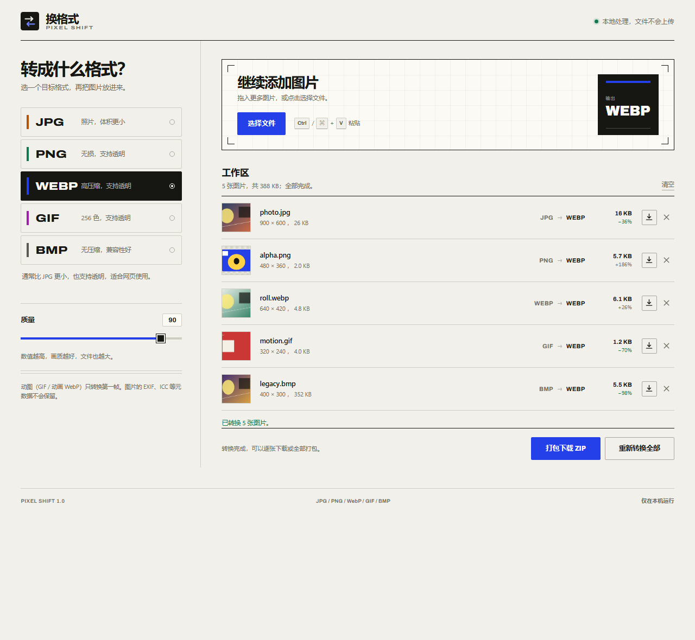

# 换格式 · Pixel Shift

一个在浏览器本地转换图片格式的扩展，兼容 Chrome 和 Edge。支持 **JPG、PNG、WebP、GIF、BMP** 五种格式任意互转。文件不会上传，扩展不申请任何浏览器权限，也不依赖网络。

官网与 ZIP 下载：[https://yyzzf.github.io/](https://yyzzf.github.io/)



## 功能

- 五种格式互相转换：JPG / PNG / WebP / GIF / BMP。
- 批量添加：拖放、选择文件，或按 `Ctrl / ⌘ + V` 粘贴剪贴板里的图片。
- 按目标格式显示可用设置：
  - JPG、WebP：质量滑杆。
  - JPG、BMP：透明区域填充颜色（白、黑或自定颜色）。
  - GIF：Floyd–Steinberg 抖动开关。
- 转换后逐张下载，或打包成 ZIP 一次下载。
- 显示转换前后尺寸与体积变化。
- 记住上次使用的格式和设置。
- 所有处理都在当前标签页内完成，不需要上传服务器。

## 安装

### Chrome

1. 打开 `chrome://extensions`。
2. 打开右上角的“开发者模式”。
3. 点击“加载已解压的扩展程序”，选择本项目的根目录（包含 `manifest.json` 的那一层）。
4. 点击工具栏上的“换格式”图标；转换器会在新标签页打开。建议把图标固定到工具栏。

### Edge

1. 打开 `edge://extensions`。
2. 打开左侧的“开发人员模式”。
3. 点击“加载解压缩的扩展”，选择本项目根目录。
4. 点击工具栏上的“换格式”图标。

> 选择项目根目录，不要选择 `src` 文件夹。若下载了发布包，请先解压，再选择解压后的目录。

## 使用

1. 在左侧选择要转成的格式。
2. 把图片拖进右侧区域，或点击“选择文件”、粘贴图片。
3. 按需调整质量、透明区域填充或 GIF 抖动。
4. 点击“开始转换”。
5. 每行右侧出现下载按钮；也可以点击“打包下载 ZIP”。

更改输出设置后，已有结果会标记为待转换，重新点击转换即可。关闭标签页会清空当前队列，但设置会保留。

## 格式说明

| 目标格式 | 透明通道 | 质量设置 | 输出特点 |
| --- | --- | --- | --- |
| JPG | 不支持，填充为指定颜色 | 有 | 有损压缩，适合照片 |
| PNG | 保留（完整 Alpha） | 无 | 无损，适合截图、图标 |
| WebP | 保留（完整 Alpha） | 有 | 浏览器编码，高压缩 |
| GIF | 保留（二值透明，阈值 Alpha 128） | 无 | 最多 256 色，可选抖动 |
| BMP | 不支持，填充为指定颜色 | 无 | 24 位未压缩位图 |

支持的输入扩展名：`.jpg`、`.jpeg`、`.png`、`.webp`、`.gif`、`.bmp`。输入图片由浏览器原生解码，因此 Chrome / Edge 能打开的 BMP、WebP、GIF 都可以处理。

## 限制

- 动图（GIF、动画 WebP）只取第一帧，输出始终是静态图片。
- 不保留 EXIF、ICC、XMP 等元数据。EXIF 方向会在解码时应用，所以画面方向是正确的，但元数据会被去掉。
- 宽色域图片会在 Canvas 中转换为普通 RGBA 像素，可能丢失原始色彩配置。
- GIF 输出为 256 色静态图；透明是二值的，半透明边缘会变成不透明或完全透明。
- BMP 输出固定为 24 位无压缩格式。
- 单张图片上限为 4800 万像素（例如 8000 × 6000）；超过时会提示，避免浏览器内存耗尽。
- 输出体积不保证比原文件小；无损格式或已经是高压缩格式的图片，重新编码后可能变大。
- 超大图片或非常复杂的 GIF 量化会在主线程同步进行，转换期间界面可能短暂停顿。

## 隐私

- `manifest.json` 不申请任何权限（没有 `permissions`、`host_permissions` 或内容脚本）。
- 扩展页面不发起网络请求；字体、图标和代码全部随扩展打包。
- 图片只在当前标签页的内存中处理，下载通过浏览器本地 Blob 完成。
- 没有统计、遥测或第三方服务。

## 项目结构

```text
manifest.json              Manifest V3 配置
src/
  background.js            点击工具栏图标时打开转换器
  converter.html           转换器页面
  styles.css               界面样式
  app.js                   队列、设置、下载与交互逻辑
  lib/
    image.js               解码、Canvas 编码、目标格式定义
    gif.js                 自写 GIF89a 编码器（中位切分量化 + 抖动 + LZW）
    bmp.js                 24 位 BMP 编码器
    zip.js                 Store 方式 ZIP 打包
assets/
  icons/                   16 / 32 / 48 / 128 图标
  fonts/                   Archivo 字体及 OFL 许可证
site/                      静态官网源码，部署到 yyzzf.github.io
tests/                     像素级测试、浏览器端到端测试、扩展与官网测试
scripts/                   图标、发布包、官网素材与部署脚本
```

## 官网

官网是一个纯静态单页，源码在 [site/](site/)，线上地址为 [https://yyzzf.github.io/](https://yyzzf.github.io/)。页面包含可交互的格式样本、格式速查、安装步骤和 ZIP 下载，不加载任何外部脚本或字体。

```bash
# 重新生成官网素材（样本图、OG 图），并打包、复制最新 ZIP 和 latest.json 到 site/downloads
npm run site:assets

# 本地打开官网并运行站点测试（截图输出到 tests/out/site/）
npm run site:test

# 构建 ZIP，克隆并推送 site/ 内容到 yyzzf.github.io
npm run site:deploy

# 如果目标 Pages 仓库已有内容，部署脚本会拒绝覆盖
npm run site:deploy -- --force
```

部署脚本默认使用 `git@github.com:yyzzf/yyzzf.github.io.git` 和 `main` 分支，可通过 `PAGES_REMOTE`、`PAGES_BRANCH` 覆盖。`site/downloads/` 里的 ZIP 和 `latest.json` 是构建产物，不提交到主源码仓库；部署时由脚本生成并复制。

`site/assets/specimen/` 中的五份样本是用同一张 1200 × 900 图形真实编码得到的，分别展示 JPG、PNG、WebP、GIF、BMP 的体积与透明差异。修改样本后运行 `npm run site:assets` 会同时更新页面读取的 `sizes.json`。

## 开发与测试

要求：

- Node.js 22+（测试脚本使用内置 `WebSocket` 和 `fetch`，无 npm 依赖）。
- Python 3，安装 Pillow 和 numpy，用于解码输出并做像素级校验。
- 本机安装 Chrome 和 Edge。

```bash
# 生成测试图片（若 tests/fixtures 已存在可跳过）
npm run fixtures

# GIF / BMP / ZIP 编码器的单元测试，并用 Pillow 解码校验
npm test

# 浏览器端到端测试：五种输入 × 五种输出、透明、填充色、
# 质量、GIF 首帧、ZIP、错误文件处理，并生成界面截图
npm run test:e2e

# 把扩展作为真正的浏览器扩展加载，验证 chrome.runtime 和转换功能
npm run test:extension

# 全部运行
npm run test:all

# 生成发布包 dist/pixel-shift-1.0.0.zip
npm run package

# 重新生成图标
npm run icons

# 官网素材、站点测试与部署
npm run site:assets
npm run site:test
npm run site:deploy
```

环境变量：

- `CHROME_PATH`：端到端测试使用的 Chrome 路径。
- `BROWSER_PATH`：扩展冒烟测试使用的浏览器路径。默认使用 Edge。

> 当前测试环境中的正式版 Chrome 155 会忽略无头模式下的命令行 `--load-extension`，因此扩展冒烟测试默认使用仍支持该参数的 Edge。页面本身的端到端测试在 Chrome 中运行，覆盖全部转换逻辑；若要在 Chrome 中测试扩展加载，可在 `chrome://extensions` 中手动加载，或使用 Chrome for Testing 并通过 `BROWSER_PATH` 指定。

测试输出：

- 单元测试：`tests/out/`
- 端到端截图和转换结果：`tests/out/e2e/`
- 扩展测试结果：`tests/out/extension/`
- 官网截图和下载包校验：`tests/out/site/`

## 字体许可

界面使用 [Archivo](https://github.com/Omnibus-Type/Archivo) 字体，采用 SIL Open Font License 1.1。许可证全文见 [assets/fonts/OFL.txt](assets/fonts/OFL.txt)。
